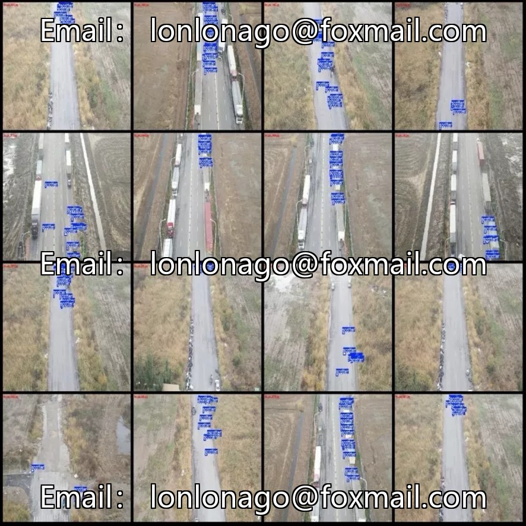
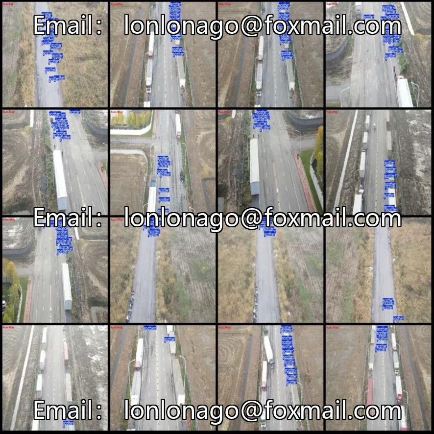
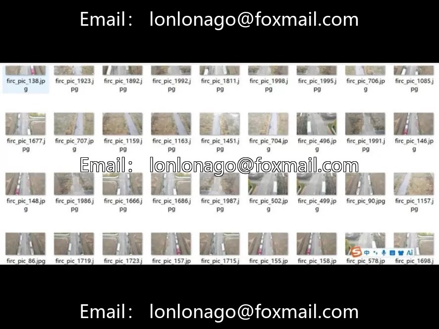

# Drone aerial photography and droplet detection dataset

## Body

Drone aerial photography litter detection dataset, drone aerial road litter detection dataset, VOC+YOLO dual format, 2133 high-definition 1920x1080 resolution images, 1 category (scatter/litter), with a total of 25,910 labeled bounding boxes, an average of 12 per image, featuring high target density suitable for small object detection and highway inspection scenarios. The dataset is not divided into training/validation/test sets, and the labeling tool used is labelImg, with rectangular box labeling.

Virtual materials, once sold, are non-refundable.
Interested friends, click "I want" to proceed.

## Images

## Payment

Here is a pay link on Stripe ( https://buy.stripe.com/3cs8yP7sY87d0vu9AB ). Please contact me lonlonago@foxmail.com after funding $89, and I will send you a complete data files , thank you!

